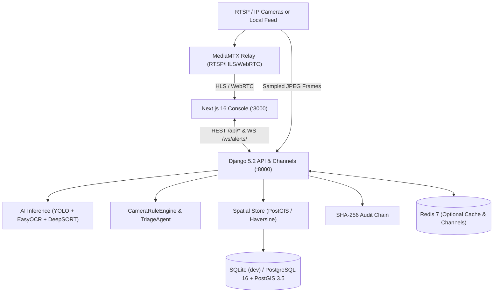

# Sentrix — Hit-and-Run Vehicle Tracing & Cross-Camera Investigation Platform

**See Sightings. Trace Trails. Respond Faster.**

[](https://github.com/PrachiBhardwaj808/Sentrix/actions/workflows/ci.yml)


Sentrix is a human-supervised AI-GIS investigation platform built for district control-room duty officers to trace hit-and-run vehicles across CCTV feeds, visualize camera-level sightings on a tactical GIS map, verify nearest available response units, and log tamper-evident custody actions.

---

## Table of Contents

- [1. Project Overview](#1-project-overview)
- [2. Problem Statement](#2-problem-statement)
- [3. Why Sentrix?](#3-why-sentrix)
- [4. Proposed Solution](#4-proposed-solution)
- [5. Key Features](#5-key-features)
- [6. Unique Selling Proposition (USP)](#6-unique-selling-proposition-usp)
- [7. Target Users](#7-target-users)
- [8. Real-World Use Cases](#8-real-world-use-cases)
- [9. System Architecture](#9-system-architecture)
- [10. End-to-End Workflow](#10-end-to-end-workflow)
- [11. Technology Stack](#11-technology-stack)
- [12. Project Directory Structure](#12-project-directory-structure)
- [13. AI and Computer Vision Pipeline](#13-ai-and-computer-vision-pipeline)
- [14. Cross-Camera Vehicle Tracing](#14-cross-camera-vehicle-tracing)
- [15. GIS and Mapping Integration](#15-gis-and-mapping-integration)
- [16. Database Design](#16-database-design)
- [17. API Documentation](#17-api-documentation)
- [18. Installation and Setup](#18-installation-and-setup)
- [19. Environment Configuration](#19-environment-configuration)
- [20. How to Run the Project](#20-how-to-run-the-project)
- [21. Demo and Screenshots](#21-demo-and-screenshots)
- [22. Testing and Validation](#22-testing-and-validation)
- [23. Performance Evaluation](#23-performance-evaluation)
- [24. Security and Privacy](#24-security-and-privacy)
- [25. Evidence Integrity and Audit Trail](#25-evidence-integrity-and-audit-trail)
- [26. Scalability and Deployment](#26-scalability-and-deployment)
- [27. Current Implementation Status](#27-current-implementation-status)
- [28. Limitations](#28-limitations)
- [29. Future Enhancements](#29-future-enhancements)
- [30. Challenges and Technical Decisions](#30-challenges-and-technical-decisions)
- [31. Team Members](#31-team-members)
- [32. Contributing](#32-contributing)
- [33. License](#33-license)
- [34. Acknowledgements](#34-acknowledgements)
- [35. Contact and Repository Links](#35-contact-and-repository-links)

---

## 1. Project Overview

Sentrix unifies CCTV stream ingestion (via MediaMTX RTSP-to-HLS/WebRTC relay or browser-sampled local video), local computer vision inference (YOLO vehicle/person detection and EasyOCR-based Indian ANPR), GIS spatial querying (PostGIS with Haversine fallback), and human-reviewed incident dispatch into one web console.

Every AI detection and candidate match is explicitly presented as an **operator-reviewable candidate** rather than an automated enforcement decision.

---

## 2. Problem Statement

After a hit-and-run incident, control-room officers often need to manually review footage from multiple disconnected CCTV cameras to identify a vehicle's movement. This process can be time-consuming and makes it difficult to establish a vehicle trail quickly. Sentrix aims to assist this process through AI-based vehicle and number-plate detection, cross-camera candidate matching, GIS-based visualization, and human-reviewed investigation workflows.

---

## 3. Why Sentrix?

District control rooms typically juggle three disconnected environments during an active hit-and-run investigation:
1. Standalone NVR/VMS monitors with no automated Indian plate normalization.
2. Separate maps or spreadsheets for locating patrol units and road corridors.
3. Manual logs with no cryptographic tamper-detection over incident actions.

Sentrix consolidates camera feeds, AI detection overlays, spatial unit lookup, and SHA-256 audit logging into a single role-gated console that works offline-first on SQLite or scales to PostgreSQL/PostGIS.

---

## 4. Proposed Solution

Sentrix provides an end-to-end investigation workspace centered on the **district control-room duty officer**:

- **Ingest & Detect:** Connects private-LAN RTSP cameras through MediaMTX (or browser-sampled local video for demos) and runs lazy-loaded YOLO vehicle detection + EasyOCR Indian ANPR.
- **Normalize & Flag:** Normalizes Indian plate strings (correcting common OCR confusions like `O/0`, `B/8`, `I/1`) and raises explainable, cooldown-bounded candidate alerts.
- **Visualize on GIS:** Maps camera-level sightings, road segments, and responder assets using PostGIS (`ST_DWithin`, `ST_DistanceSphere`, `ST_MakeEnvelope`) or straight-line Haversine fallback.
- **Review & Dispatch:** Requires an authenticated operator (`command` or `admin` tier) to confirm candidates, identify nearest units, and initiate OTP-verified dispatch.
- **Audit:** Appends every alert and activity mutation to a local SHA-256 hash chain verifiable via `/api/audit-chain`.

---

## 5. Key Features

### Core Investigation Capabilities (Implemented / Verified in Code)
- **CCTV Vehicle & Person Detection:** Ultralytics YOLO detection (COCO vehicle classes `2, 3, 5, 7` and person tracking via DeepSORT).
- **Indian ANPR & Plate Normalization:** Dedicated plate detector support (`ANPR_PLATE_MODEL_PATH`) with automatic vehicle-crop EasyOCR fallback and Indian registration format validation (standard, older, temporary, and Bharat-series `BH` plates).
- **Explainable Camera Rules & Triage:** Camera-scoped rules (`repeated_plate`, `virtual_fence_intrusion`, `loitering`, `night_movement`, `crowd_formation`) producing operator-reviewable incident candidates.
- **GIS Command Map:** Interactive Leaflet map with viewport-paginated features (`/api/map/features`), offline-first search (`/api/map/search`), and per-location workspace (`/api/map/workspace`).
- **Nearest-Responder Lookup & OTP Dispatch:** Straight-line proximity query (`/api/map/nearest-responders`), corridor check (`/api/map/route`), and 6-digit OTP dispatch verification (`/api/alerts/<id>/dispatch`).
- **Tamper-Evident Audit Chain:** Local SHA-256 hash chain over `alerts` and `activityLog` with integrity verification (`/api/audit-chain`).
- **Role-Based Access & Security:** Signed 12-hour Bearer tokens, optional 2FA OTP, WebAuthn passkeys, private-IP RTSP SSRF protection, and masked camera credentials.

### Partially Implemented / Supporting Features
- **Cross-Camera Vehicle Tracing:** Single-camera `repeated_plate` detection, plate `watchlist`, and camera-level alert coordinates are implemented; automated multi-camera fuzzy plate-similarity and travel-time trail linking is **planned / in progress**.
- **Real-Time WebSocket Updates:** Works on ASGI (`/ws/alerts/` via Django Channels + Daphne in local `runserver` and tests); `docker-compose.production.yml` currently runs Gunicorn WSGI and needs switching to Daphne/ASGI for production WebSockets.

---

## 6. Unique Selling Proposition (USP)

1. **Human-in-the-Loop by Design:** AI outputs are strictly candidate observations (`requiresOperatorReview: true`); no automated dispatch or enforcement occurs without officer confirmation.
2. **Unified Investigation & Dispatch Console:** Combines CCTV inference overlays, GIS camera-level visualization, straight-line responder lookup, OTP-verified dispatch, and a tamper-evident SHA-256 audit chain in one role-gated workflow.
3. **Graceful Spatial Fallback:** Uses PostGIS GiST/geography operators in PostgreSQL and falls back to in-memory Haversine calculations when running without PostGIS.

---

## 7. Target Users

- **Primary User:** District Control-Room Duty Officer (`command` tier) — reviews incoming sightings, confirms candidate vehicle matches, inspects GIS trails, and dispatches response units.
- **System Administrator (`admin` tier):** Configures cameras, manages operator accounts/revocations, imports GeoJSON layers, and audits hash-chain integrity.
- **Field Response Unit (`guard` / responder):** Receives dispatch assignments and verifies arrival/handover via 6-digit OTP.

---

## 8. Real-World Use Cases

| Use Case | Scope Status | Description |
|---|---|---|
| **Hit-and-Run Vehicle Tracing** | **Primary Focus (Core)** | Detect suspect vehicles/plates on CCTV, review candidate sightings on GIS, and dispatch the nearest patrol unit. |
| **Repeated-Plate Watchlist Alerting** | **Implemented (Single-Camera)** | Flag plates appearing multiple times within 5 minutes or matching registered plate watchlist entries. |
| **Missing-Person Facial Matching** | **Future Scope** | Currently only face localization (`opencv_yolo` / Haar fallback) with `unidentified_face_review` exists; consent-gated recognition is disabled by default. |
| **Traffic Monitoring / Accident Detection** | **Future / Optional** | Vehicle detection exists; dedicated accident classification and city-wide traffic analytics are outside the core baseline. |
| **Disaster Management / Border / Predictive Heatmaps** | **Future Scope** | Demoted from core scope; no trained predictive forecasting model exists. |

---

## 9. System Architecture



For full component boundaries, sequence diagrams, and data contracts, see [docs/ARCHITECTURE.md](docs/ARCHITECTURE.md).

---

## 10. End-to-End Workflow

1. **Incident Reported:** Duty officer logs an incident or monitors incoming feeds in the console.
2. **Footage Analysis:** Sampled frames from RTSP/MediaMTX or local video are sent to `POST /api/inference/frame`.
3. **Vehicle & ANPR Detection:** YOLO localizes vehicles; ANPR extracts and normalizes Indian plate strings with detection + OCR confidence.
4. **Candidate Association & GIS View:** Alerts store normalized `plateNumber`, `timestamp`, and camera-level `coordinates` for map inspection. *(Automated cross-camera fuzzy trail linking is planned.)*
5. **Operator Review:** Officer reviews candidate sightings (`requiresOperatorReview: true`) and marks/acknowledges confirmed matches.
6. **Responder Lookup & Dispatch:** `GET /api/map/nearest-responders` ranks units by straight-line PostGIS/Haversine distance; `POST /api/alerts/<id>/dispatch` assigns a unit with a 6-digit OTP.
7. **Audit Logging:** Alert and activity mutations are appended to the SHA-256 hash chain (`GET /api/audit-chain`).

---

## 11. Technology Stack

Verified directly from [frontend/package.json](frontend/package.json), [backend/requirements-web.txt](backend/requirements-web.txt), [backend/requirements-ai.txt](backend/requirements-ai.txt), [backend/requirements-services.txt](backend/requirements-services.txt), and [docker-compose.production.yml](docker-compose.production.yml):

| Layer | Technologies & Versions |
|---|---|
| **Frontend** | Next.js `^16.3.8` (App Router), React `^18.3.1`, TypeScript `^5.6.3`, Tailwind CSS `^3.4.19`, Zustand `^4.5.5`, Leaflet `^1.9.4`, `react-leaflet` `^4.2.1`, Recharts `^2.13.0`, `hls.js` `^1.7.2` |
| **Backend** | Python `3.12`, Django `>=5.2,<6`, Django Channels `>=4.0,<5.0`, Daphne `>=4.0,<5.0`, Gunicorn `>=23.0,<24.0`, `psycopg[binary]` `>=3.2,<4.0`, `webauthn` `>=3.0,<4.0` |
| **AI / Computer Vision** | PyTorch `>=2.2`, Torchvision `>=0.17`, Ultralytics YOLO `>=8.1,<9.0`, EasyOCR `>=1.7,<1.8`, `deep-sort-realtime` `>=1.3`, `opencv-python-headless` `>=4.8,<5.0`, NumPy `>=1.24,<2.0` |
| **Database & Cache** | SQLite (local default), PostgreSQL 16 + PostGIS 3.5 (`postgis/postgis:16-3.5`), Redis 7 (`redis:7-alpine`, `redis>=5.2,<7.0`, `channels-redis>=4.0,<5.0`) |
| **Media & Reverse Proxy** | MediaMTX (`bluenviron/mediamtx:latest`), Caddy 2 (`caddy:2-alpine`) |
| **Optional Integrations** | `firebase-admin` `>=6.5,<7.0`, `web3` `>=7.0,<8.0`, Exotel SMS REST API, Pinata IPFS API |
| **Testing & CI** | Python `unittest` (95 tests), Vitest `^2.1.8` (7 tests), Ruff, Gitleaks, GitHub Actions |

---

## 12. Project Directory Structure

```text
Sentrix/
├── .github/workflows/ci.yml           # CI pipeline (backend, frontend, gitleaks)
├── backend/
│   ├── app/
│   │   ├── api/                       # views.py, routes/map.py, consumers.py, routing.py, repository.py
│   │   ├── management/commands/       # seed_demo.py, clear_demo_data.py, import_local_state.py
│   │   ├── migrations/                # 0001_initial.py, 0002_spatial_features.py
│   │   ├── models.py                  # ApiStateDocument
│   │   └── services/
│   │       ├── analytics/rules.py     # CameraRuleEngine (repeated_plate, fence, dwell, night, crowd)
│   │       ├── audit/chain.py         # Local SHA-256 hash chain
│   │       ├── cameras/               # Private-IP validation & MediaMTX relay registration
│   │       ├── evidence/              # Hashing, custody, optional Pinata & Firestore sink
│   │       ├── inference/             # LiveInferencePipeline, ANPR, person, face
│   │       ├── notifications/         # Exotel SMS, OTP, optional FCM
│   │       ├── spatial_store.py       # PostGIS GiST & Haversine fallback
│   │       └── triage/agent.py        # Reviewable incident fusion
│   ├── blockchain/contracts/          # Optional EvidenceRegistry.sol (frozen/secondary)
│   ├── config/                        # settings.py, urls.py, asgi.py, wsgi.py, mediamtx.yml
│   ├── tests/                         # 22 unit test files (88 tests)
│   ├── requirements-web.txt
│   ├── requirements-services.txt
│   ├── requirements-ai.txt
│   └── Dockerfile
├── frontend/
│   ├── app/                           # Next.js App Router pages ((console), login)
│   ├── components/                    # Map, video, console, guard, demo, shared UI
│   ├── lib/                           # API client, WebSocket manager, Zustand store, geospatial search
│   ├── package.json
│   └── Dockerfile
├── docs/
│   ├── ARCHITECTURE.md                # Consolidated system architecture & data flows
│   ├── HOW_TO_RUN.md                  # Consolidated setup, run, Docker, & troubleshooting guide
│   ├── README.md                      # Documentation index
│   ├── blockchain/                    # Secondary/frozen Web3 & Pinata notes
│   ├── deployment/                    # Hardware & deployment planning
│   ├── implementation/                # Historical implementation notes
│   └── reports/PRODUCTION_READINESS.md
├── infrastructure/
│   ├── deployment/                    # Caddyfile, .env.example, production README
│   ├── docker/mediamtx.yml
│   └── firebase/                      # Firestore rules & indexes
├── scripts/                           # start_all.bat, start_all.sh, README.md
├── docker-compose.yml                 # Local dev stack
└── docker-compose.production.yml      # Single-host production baseline
```

---

## 13. AI and Computer Vision Pipeline

- **Lazy Initialization:** Models load on first inference request, keeping Django web startup lightweight.
- **Vehicle & Plate Detection (`backend/app/services/inference/anpr/service.py`):**
  - Detects vehicles in COCO classes `{2: car, 3: motorcycle, 5: bus, 7: truck}`.
  - Runs dedicated plate detection (`ANPR_PLATE_MODEL_PATH`) when weights are present, or falls back to scanning vehicle crops with EasyOCR.
- **Person Tracking (`backend/app/services/inference/person/service.py`):** YOLO + DeepSORT with per-camera tracker instances.
- **Face Detection Boundary (`backend/app/services/inference/face/service.py`):** Optional detection-only boundary (`opencv_yolo` / Haar fallback); identity matching is disabled by default (`FACE_MATCHING_ENABLED=false`).

---

## 14. Cross-Camera Vehicle Tracing

- **Plate Normalization (`plate_format.py`):** Strips punctuation, checks `8–11` character length, tests legal Indian plate splits against `^[A-Z]{2}\d{1,2}[A-Z]{1,3}\d{1,4}$`, and repairs OCR character confusions (`0↔O`, `1↔I/L`, `2↔Z`, `5↔S`, `8↔B`).
- **Implemented Today:** Single-camera `repeated_plate` rule (5-minute rolling window), `plate` watchlist entries (`/api/watchlist`), and `plateNumber` + camera coordinates on alerts.
- **Planned:** Automated cross-camera sighting association using fuzzy plate edit distance, inter-camera distance, and travel-time plausibility scoring with per-link confidence.

---

## 15. GIS and Mapping Integration

- **Camera-Level Positioning:** Sightings are plotted at the **camera's registered coordinates** (WGS84 `lat`/`lng`), not exact ground-plane vehicle coordinates (image-to-ground homography is not implemented).
- **Spatial Engine (`spatial_store.py`):** Uses PostGIS `sentrix_spatial_features` (`ST_MakeEnvelope`, `ST_DWithin`, `ST_DistanceSphere`) when PostgreSQL/PostGIS is active, and falls back to in-memory **straight-line Haversine** distance on SQLite.
- **Corridor Check (`/api/map/route`):** Evaluates proximity to registered `roads` marked `open` vs `affected`/`blocked` using straight-line geometry; full road-network drive-time routing is future work.

---

## 16. Database Design

| Store | Purpose | Technology |
|---|---|---|
| **Operational State (`sentrix_api_state`)** | Single canonical state document (`ApiStateDocument`) for alerts, cameras, guards, shifts, watchlist, and audit chain | SQLite (dev) / PostgreSQL JSONB (prod) |
| **Spatial Index (`sentrix_spatial_features`)** | PostGIS `GEOMETRY(Geometry, 4326)` + GiST index for `communities`, `resources`, `infrastructure`, and `roads` | PostgreSQL 16 + PostGIS 3.5 |
| **Cloud Projection (Optional)** | Idempotent alert sync + append-only `alerts_events` with 8-retry local outbox | Google Cloud Firestore |

---

## 17. API Documentation

All REST endpoints are mounted under **`/api`** (from [backend/config/urls.py](backend/config/urls.py)). Protected endpoints require `Authorization: Bearer <token>`.

| Category | Method & Route | Auth / Role | Purpose |
|---|---|---|---|
| **Health & Audit** | `GET /api/health` | Public | Service & dependency health |
| | `GET /api/audit-chain` | Authenticated (`command`/`admin`) | Verify SHA-256 hash chain |
| | `GET /api/monitoring/metrics` | Authenticated | Inference latency (p50/p95) & FPS metrics |
| **Auth** | `POST /api/auth/login` | Public (rate-limited) | Password login + optional 2FA OTP challenge |
| | `POST /api/auth/verify-otp` | Public | Complete 2FA login |
| | `POST /api/auth/passkey/options`, `/verify` | Public | WebAuthn / FIDO2 login |
| | `POST /api/auth/revoke` | `admin` | Revoke operator tokens (`tokenVersion`) |
| **Inference & Analytics** | `POST /api/inference/frame` | Authenticated | Run YOLO / ANPR / face detection on one JPEG frame |
| | `POST /api/analytics/evaluate` | Authenticated | Evaluate `CameraRuleEngine` & persist alerts |
| | `POST /api/analytics/triage` | Authenticated | Fuse detections into reviewable incident |
| **Alerts & Dispatch** | `GET /api/alerts`, `POST /api/alerts/<id>/action` | Authenticated | List, acknowledge, escalate, or resolve alerts |
| | `POST /api/alerts/<id>/dispatch` | `command` / `admin` | Assign guard & issue 6-digit dispatch OTP |
| | `POST /api/alerts/<id>/dispatch-otp/verify` | Public (challenge-bound) | Verify guard dispatch OTP |
| **Watchlist & Cameras** | `GET/POST /api/watchlist`, `DELETE /api/watchlist/<id>` | Authenticated | Manage `plate` / `face` watchlist entries |
| | `POST /api/cameras/test`, `GET /api/cameras/<id>/stream` | Authenticated | Validate private-IP RTSP & return HLS/WebRTC URLs |
| **GIS & Map** | `GET /api/map/search`, `/nearby`, `/features`, `/workspace` | Authenticated | Map search, radial assets, paginated bbox features |
| | `GET /api/map/nearest-responders`, `/route` | Authenticated | Straight-line nearest units & corridor check |
| **WebSocket** | `WS /ws/alerts/` | ASGI / Channels | Live `alert.*`, `camera.*`, `dispatch.*`, `system.*` events |

---

## 18. Installation and Setup

See [docs/HOW_TO_RUN.md](docs/HOW_TO_RUN.md) for complete instructions. Quick summary:

```bash
git clone https://github.com/PrachiBhardwaj808/Sentrix.git
cd Sentrix

# Backend
cd backend
python -m venv venv
venv\Scripts\activate          # or: source venv/bin/activate
pip install -r requirements-web.txt -r requirements-services.txt
pip install torch torchvision --index-url https://download.pytorch.org/whl/cpu
pip install -r requirements-ai.txt
python manage.py check && python manage.py migrate

# Frontend (in a second terminal)
cd frontend
npm ci
```

---

## 19. Environment Configuration

Copy the example templates and configure secrets outside Git:
- [backend/.env.example](backend/.env.example) -> `backend/.env`
- [frontend/.env.example](frontend/.env.example) -> `frontend/.env.local`
- [infrastructure/deployment/.env.example](infrastructure/deployment/.env.example) -> `infrastructure/deployment/.env` (for production Compose)

Never set `AUTH_ALLOW_DEMO_USERS=true`, `AUTH_ALLOW_DEMO_OTP=true`, or `SENTRIX_ENABLE_DEMO_DATA=true` in production.

---

## 20. How to Run the Project

- **Local Development:** Run `python manage.py runserver 127.0.0.1:8000` in `backend/` and `npm run dev` in `frontend/`, or use `scripts\start_all.bat` (Windows) / `./scripts/start_all.sh` (Linux/macOS).
- **Docker Dev Stack:** `docker compose build && docker compose up -d` (starts MediaMTX, Django backend with AI in CPU mode, and Next.js frontend).
- **Console URL:** `http://localhost:3000` | **API Health:** `http://127.0.0.1:8000/api/health`

---

## 21. Demo and Screenshots

- **Local Camera / Video Demo:** Navigate to `http://localhost:3000/live-feed` and click **Enable Local Camera** (or load a local video) to test live vehicle, person, and ANPR bounding boxes via `/api/inference/frame`.
- **Map & Dispatch Demo:** Navigate to `http://localhost:3000/map` and `http://localhost:3000/alerts` to inspect camera locations, responder proximity, and OTP-verified dispatch.
- *Screenshots:* No static screenshot assets are currently committed in the repository; capture live console views from `/live-feed`, `/alerts`, and `/map` during demonstrations.

---

## 22. Testing and Validation

Verified locally and configured in [.github/workflows/ci.yml](.github/workflows/ci.yml):

| Suite | Command (from repo root or `frontend/`) | Verified Result |
|---|---|---|
| **Backend Unit Tests** | `DJANGO_DEBUG=true python -m unittest discover -s backend/tests -v` | **95 tests across 23 files passed** |
| **Django System Check** | `DJANGO_DEBUG=true python backend/manage.py check` | Configuration check |
| **Frontend Unit Tests** | `cd frontend && npm test` | **7 tests across 2 files passed** (`search.test.ts`, `websocket.test.ts`) |
| **Frontend Typecheck & Build** | `cd frontend && npm run typecheck && npm run build` | Enforced in GitHub Actions CI |

---

## 23. Performance Evaluation

- **Measured Prototype Throughput** (from [docs/deployment/hardware-and-deployment.md](docs/deployment/hardware-and-deployment.md), local CPU-only test):
  - Person + face pipeline: ~**3 FPS** on one camera.
  - Combined person + face + ANPR pipeline: ~**0.3 FPS** on one camera (EasyOCR is CPU-intensive, motivating frame-skipping via `AI_ANPR_FRAME_INTERVAL`).
- **Detection Accuracy:** **Not yet benchmarked.** No precision, recall, F1, or OCR character-error-rate evaluation on a labeled Indian hit-and-run/CCTV dataset has been published.

---

## 24. Security and Privacy

- **Access Control & Auth:** Role-based access (`admin`, `command`, `guard`/`operator`) enforced server-side on every protected endpoint; rate-limited login attempts; token revocation via `tokenVersion`.
- **CCTV Network Isolation:** Private-IP validation rejects public WAN RTSP targets (SSRF prevention); camera passwords are never returned to the browser.
- **Biometric & Data Minimization:** Face identity matching is disabled by default (`FACE_MATCHING_ENABLED=false`). Plate text and detections are treated as sensitive data.
- **Indian Legal Context (Requires Legal Review):** Any operational deployment in India must be reviewed against the **Digital Personal Data Protection Act, 2023** (lawful basis, purpose limitation, retention, and security safeguards) and **Bharatiya Sakshya Adhiniyam, 2023 (Section 63)** / **IT Act, 2000** for electronic evidence certification—neither of which is automatically satisfied by software alone.
- **Operational Risks:** Wrong-match false positives (mitigated by mandatory operator review), camera/relay outages, and external SMS/cloud failures (mitigated by local SQLite/outbox persistence).

---

## 25. Evidence Integrity and Audit Trail

- `backend/app/services/audit/chain.py` maintains a sequential SHA-256 hash chain (`sequence`, `collection`, `operation`, `recordId`, `contentHash`, `previousHash`, `chainHash`, `recordedAt`) covering `alerts` and `activityLog`.
- `GET /api/audit-chain` recomputes every link from `GENESIS_HASH` to detect retroactive edits or deletions.
- **Honest Boundary:** This is a **tamper-evident local hash chain**, not an immutable legal ledger; it detects post-hoc edits in stored state but cannot prove writer truthfulness at creation time without external durable append-only storage and organizational access controls.

---

## 26. Scalability and Deployment

- **Development Baseline:** `docker-compose.yml` (MediaMTX + Django + Next.js).
- **Single-Host Production Baseline:** `docker-compose.production.yml` (Caddy 2 TLS + Next.js + Django Gunicorn `--workers 1` + PostgreSQL 16/PostGIS 3.5 + Redis 7 + MediaMTX on internal Docker networks).
- **Current Scaling Bottleneck:** Canonical operational state resides in a single `ApiStateDocument` (`sentrix_api_state`), restricting the backend to 1 worker until records are normalized into row-level relational tables.

---

## 27. Current Implementation Status

| Module | Status | Description |
|---|---|---|
| **Vehicle Detection** | **Implemented (Unbenchmarked)** | Ultralytics YOLO vehicle localization (COCO classes `2, 3, 5, 7`) in `AnprService`; accuracy not yet benchmarked. |
| **ANPR & Plate Normalization** | **Implemented (Unbenchmarked)** | Dedicated plate model or vehicle-crop EasyOCR fallback + Indian plate format/OCR-confusion normalization (`plate_format.py`); 2 unit tests pass. |
| **Cross-Camera Tracing** | **Partial (Core Logic Implemented)** | OCR-confusion fuzzy similarity, wildcard search (`DL1?ER48??`), and speed-plausibility trail linking implemented & tested in `tracing.py`; relational sightings store, API endpoint, and map trail UI remain to be wired. |
| **GIS Visualization** | **Verified (Local Tests)** | Leaflet map, `/api/map/features`, `/search`, `/nearby`, `/workspace`, and PostGIS/Haversine spatial store verified in unit tests. |
| **Evidence Integrity** | **Verified (Local Tests)** | Local SHA-256 hash chain with optional `AUDIT_CHAIN_HMAC_KEY` HMAC-SHA256 signing over `alerts`, `activityLog`, and `vehicleSightings` verified in `test_audit_chain.py`. |
| **Operator Review & Triage** | **Verified (Local Tests)** | `CameraRuleEngine`, `TriageAgent`, `requiresOperatorReview`, and `alert_action` lifecycle verified in unit tests. |
| **Dispatch & OTP** | **Verified (Local Tests)** | Straight-line nearest-responder lookup + `command`/`admin` dispatch + 6-digit OTP verification verified in unit tests (Exotel SMS mocked in tests). |
| **Real-Time WebSockets** | **Partial (ASGI Only)** | Works on ASGI (`/ws/alerts/` in local `runserver`/Daphne and unit tests); `docker-compose.production.yml` currently uses Gunicorn WSGI and needs Daphne for production WebSockets. |

---

## 28. Limitations

1. **No End-to-End Cross-Camera Trail Engine Yet:** Multi-camera fuzzy plate association and travel-time plausibility filtering are not yet implemented.
2. **Camera-Level Coordinates Only:** Map markers reflect camera locations, not ground-plane vehicle coordinates.
3. **Straight-Line Distance Only:** Nearest-responder and corridor calculations use PostGIS `ST_DistanceSphere` or Haversine, not road-network drive-time routing.
4. **Single-Worker State Document:** `ApiStateDocument` prevents horizontal multi-worker backend scaling without table normalization.
5. **Unbenchmarked AI Accuracy:** Only runtime latency/FPS is measured; precision/recall on real CCTV footage is unmeasured.

---

## 29. Future Enhancements

- Automated cross-camera vehicle trail association (fuzzy plate matching + travel-time plausibility + per-link confidence).
- Road-network drive-time routing (e.g., OSRM / Valhalla / pgRouting) replacing straight-line Haversine/sphere distance.
- Camera-to-ground homography projection for more accurate vehicle map placement.
- Relational normalization of `alerts`, `cameras`, and `guards` for multi-worker ASGI/Gunicorn scaling.
- Labeled Indian CCTV/ANPR benchmark dataset and published precision/recall/CER metrics.
- Consent-gated missing-person facial matching with formal legal/privacy governance.

---

## 30. Challenges and Technical Decisions

- **CPU OCR Latency:** Running EasyOCR on every frame dropped CPU throughput to ~0.3 FPS; solved via frame-skipping (`AI_ANPR_FRAME_INTERVAL`), bounding-box caching, and vehicle-crop-first scanning.
- **SQLite vs. PostGIS Portability:** Designed `spatial_store.py` to use PostGIS GiST/geography operators in PostgreSQL while falling back cleanly to in-memory Haversine on SQLite so developers and judges can run Sentrix with zero external DB setup.
- **Security vs. Demo Usability:** Gated demo users, demo OTP, and demo seeding behind explicit opt-in flags (`false` by default in production Compose).

---

## 31. Team Members

- **Prachi Bhardwaj** — Repository Owner & Developer ([GitHub](https://github.com/PrachiBhardwaj808))
- **Akshit Sharma** — Core Contributor

*(Update with full team roles and affiliations as needed for competition submissions.)*

---

## 32. Contributing

1. Branch from `main` using descriptive names (`feature/<name>`, `fix/<issue>`).
2. Format Python with Ruff/Black (120-char line limit per `pyproject.toml`) and verify TypeScript (`npm run typecheck`).
3. Ensure backend (`unittest`) and frontend (`vitest`) tests pass before opening a pull request.
4. Never commit `.env` files, model weights, camera credentials, or real CCTV media.

---

## 33. License

The Sentrix application code is licensed under the MIT License — see [LICENSE](LICENSE). Optional AI runtime dependencies in [backend/requirements-ai.txt](backend/requirements-ai.txt) include **Ultralytics YOLO (`ultralytics`)**, which is dual-licensed under **AGPL-3.0** or a commercial license; production or commercial deployments must comply with AGPL-3.0, obtain a commercial Ultralytics license, or swap in a permissively licensed detector. See [backend/THIRD_PARTY_NOTICES.md](backend/THIRD_PARTY_NOTICES.md) for full third-party notices.

---

## 34. Acknowledgements

- Ultralytics YOLO, EasyOCR, DeepSORT, Django, Django Channels, Next.js, Leaflet, PostGIS, and MediaMTX open-source communities.

---

## 35. Contact and Repository Links

- **Repository:** [https://github.com/PrachiBhardwaj808/Sentrix](https://github.com/PrachiBhardwaj808/Sentrix)
- **Architecture Guide:** [docs/ARCHITECTURE.md](docs/ARCHITECTURE.md)
- **Setup & Run Guide:** [docs/HOW_TO_RUN.md](docs/HOW_TO_RUN.md)
- **Production Readiness Record:** [docs/reports/PRODUCTION_READINESS.md](docs/reports/PRODUCTION_READINESS.md)
