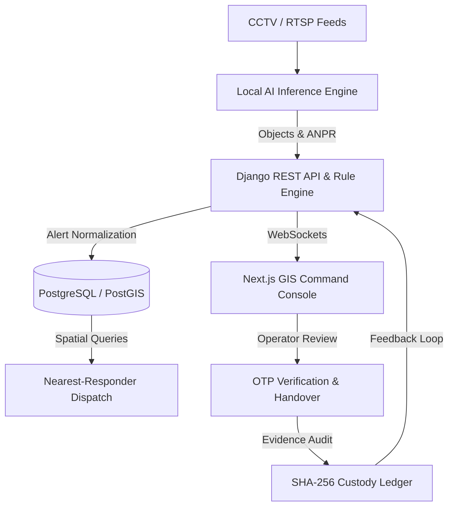
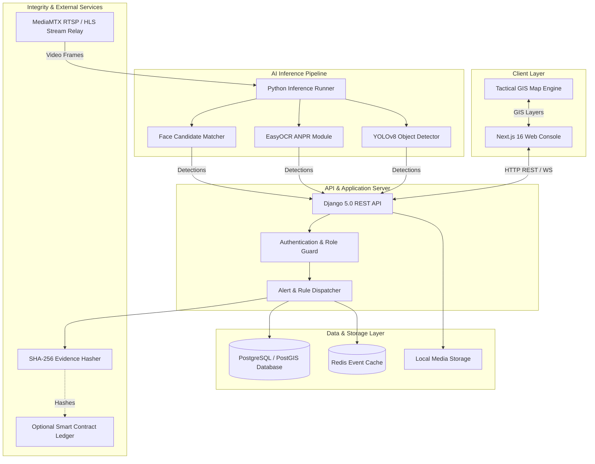

# Sentrix

**See Risks. Map Impact. Respond Faster.**


An AI-GIS public safety and community resilience intelligence platform for Indian districts. It detects, locates, predicts, maps impact, and coordinates response to risks while keeping authorized people in the decision loop.

Sentrix now includes the project-reframed MVP described in `GeoLens_New_Features_and_Project_Reframing.docx`: an interactive multi-layer GIS intelligence map, real-time incident mapping, explainable risk scores, predictive hotspots, community vulnerability mapping, community incident reports, AI/community correlation, nearby resource identification, response and route recommendations, critical-infrastructure impact, heatmaps, historical analytics, and a human-reviewed emergency/disaster extension path. Operational records and GIS reference layers are backend-owned; the production UI does not fabricate records when the API is empty.

---

## Current implementation supplement

**This section supplements the original project overview below; it does not replace or remove it.** The sections that follow preserve the original product framing, use cases, illustrative story, diagrams, setup notes, and reference material. Some describe the intended product direction rather than a verified, connected production deployment. For the state of the current code, use this supplement together with [PRODUCTION_READINESS.md](PRODUCTION_READINESS.md).

### What is present now

| Area | Current implementation status | Boundary to keep in mind |
|---|---|---|
| Operator console | Dashboard, alerts, map, live-feed, camera management, guard-duty, analytics, and admin screens exist. | `/intelligence` redirects to `/alerts`; `/logistics` redirects to `/dashboard`; several guard subroutes redirect to `/guard-duty`. |
| Authentication | Signed expiring sessions, password/passkey paths, role checks on protected backend actions, optional OTP, account revocation, and auth audit events. | Real operator accounts, account recovery, identity provider, SMS delivery, and production settings still need configuration and testing. |
| Alert workflow | Backend APIs support reviewing alerts and status actions, with activity records and optional evidence-related actions. | Operational escalation policy, paging, record-level history, retention, and high-volume pagination are not complete. |
| Interactive GIS | Leaflet map supports pan/zoom, selectable incidents, layer toggles, and an impact inspector. | Results depend on correct, current, licensed GIS records and a permitted tile provider. Several impact/risk values are heuristics. |
| GIS import and query | Admin GeoJSON import supports Point communities/resources/infrastructure and LineString roads, with validation and size/count limits. Production config includes a PostGIS feature table/index and viewport-query path. | CSV/KML and richer geometries are not supported. The PostGIS runtime was not exercised in the earlier environment. Canonical application state remains a single JSONB document. |
| AI and cameras | Person, face-detection, and ANPR adapters, normalized inference results, camera test/registration paths, and relay configuration are present. | Model weights, AI libraries, compatible hardware, a reachable camera, and a live relay are required. Accuracy and full browser/relay playback have not been production-validated. A frame-inference result does not itself create a reviewed incident. |
| Risk, impact, and routes | Current UI can calculate rule-based risk, correlations, nearby resources/communities/infrastructure, and simple route suggestions. | These are not validated forecasts or road-network navigation. “Nearest” means geometric distance, not drive time. |
| Dispatch and OTP | Guard assignment, OTP issue/verification, and handover API paths exist. | Real SMS requires approved Exotel credentials and delivery testing. Demo OTP is for explicitly enabled local testing only. |
| Evidence and audit | SHA-256 hashing, a local verifiable hash chain, and optional Firebase, private Pinata, and blockchain adapters exist. | Optional services need credentials, resources, retention policy, and end-to-end testing. A hash is not encryption or immutable storage. |
| Production services | Compose defines Caddy, frontend, Django, PostgreSQL/PostGIS, Redis, and MediaMTX with private internal networks for services. | This is a deployment baseline, not a deployed environment. Host firewall, WAF, DNS, secrets, backups, monitoring, and live container verification remain deployment tasks. |
| CI | GitHub Actions runs backend tests/configuration checks and frontend typecheck/build. | A recent backend run failed because CI did not install OpenCV (`cv2`), which one inference test imports. The frontend job passed. The workflow install step currently omits `requirements-ai.txt`. |

### Actual operator and data workflow

The flow below describes how the code paths fit together. It is conditional on the relevant services being configured; it is not a claim that production cameras, models, SMS, or cloud services are already connected.

1. **Sign in.** The operator opens the Next.js console and uses a configured password or passkey path. Django verifies credentials, applies per-operator login throttling, and issues a signed, expiring session with an access tier. If second factor is enabled, the backend creates an OTP challenge and uses the configured delivery integration. Demo accounts and demo OTP are disabled by default. Frontend route guards are for navigation; backend authorization is the security boundary.
2. **Load the console.** The frontend hydrator calls `/api/bootstrap` and loads current alerts, cameras, guards, sectors, and GIS records into the UI store. This is an initial fetch, not continuous push: the current API does not expose a WebSocket or server-sent-events channel. User actions/reloads cause subsequent API requests.
3. **Acquire a camera observation.** A registered camera must be reachable on an approved private network. A configured MediaMTX relay can make an RTSP source available through a browser-compatible stream. For local development, the browser can capture a user-approved local camera. Raw RTSP is not directly playable in browsers, and camera credentials must remain server-side.
4. **Run inference when configured.** The backend `/api/inference/frame` endpoint can call enabled person tracking, face localization, and ANPR/OCR modules when dependencies, approved model weights, and appropriate runtime hardware are present. It returns normalized detection data and module/latency information. Optional face-embedding comparison is a separate, disabled-by-default capability. This endpoint does not, on its own, persist an alert or authorize a response.
5. **Evaluate and review.** Analytics and triage code can provide rule-based, explainable candidate details. Candidates may come from operators, community reports, or an integrated detection caller. An authorized person should review source, time, location, evidence, false-positive risk, and policy before recording or acting on an incident. Current risk calculations are heuristics, not validated predictive analytics.
6. **Inspect geographic context.** The operator selects an incident on the Leaflet map and checks configured camera, resource, community, road, and infrastructure layers. Viewport changes can request matching spatial features. An administrator can upload a constrained GeoJSON FeatureCollection. The import validates geometry and coordinate format; it cannot certify source accuracy, freshness, licensing, or completeness.
7. **Assign and verify response.** An authorized command/admin operator assigns a guard and starts the dispatch flow. The backend creates a time-limited OTP with bounded verification attempts. Exotel can deliver real SMS only when configured. On arrival, an authorized user verifies the challenge and the workflow records handover/activity information. A code path cannot prove that a guard received a message or physically arrived.
8. **Record evidence and audit metadata.** The evidence utilities can hash bytes with SHA-256 and record custody/activity metadata. The local audit chain can be checked for consistency. Optional integrations can project events to Firebase, upload evidence to private Pinata storage, or anchor hashes/custody entries through a deployed contract. Each external integration needs credentials, service-side policies, and recovery testing.
9. **Close and monitor.** The operator resolves the alert or marks it false positive. Health, metrics, Firebase/blockchain status, and audit verification endpoints support diagnostics. Production still requires centralized logs, monitoring/alerting, backups, recovery exercises, retention rules, and human operational ownership.

```text
Operator -> sign in -> load backend records -> observe camera/report
         -> optional inference/rule evaluation -> human review
         -> inspect GIS context -> assign responder -> verify handover
         -> record audit/evidence metadata -> resolve and monitor
```

### How map, risk, and inference outputs should be interpreted

- The map’s resource ordering uses straight-line distance. Route suggestions use the road status and nearby incident records currently loaded by the app; this is not a live road-network routing engine.
- Risk and community vulnerability scores use configured alert/camera/community fields and fixed application rules. They are not trained forecasts, validated safety scores, or a substitute for local operating policy.
- Face detection only locates a face. It does not identify a person. Face comparison is a separate, optional path and should remain consent-/authorization-governed and operator-reviewed.
- AI feature availability is not a claim of accuracy. Before operational use, test representative authorized footage, measure false positives/negatives and precision/recall, record model/version/license, and define human-review procedures.
- A local audit hash chain is an integrity signal, not a tamper-proof database. Hashing does not encrypt evidence. External storage and blockchain adapters are optional and need real deployment configuration.

### API route correction

The current Django routes are rooted directly at `/api` (for example `/api/health`, `/api/bootstrap`, `/api/inference/frame`, and `/api/alerts`), not `/api/v1`. The current route table does not implement the `/ws/alerts/` WebSocket endpoint shown in the original architecture/API material below. Refer to `backend/config/urls.py` and `backend/app/api/views.py` for the live route definitions and permissions.

### Current verification and deployment boundary

The repository is pushed to the Sentrix `main` branch. The recent GitHub notifications were failed Actions checks, not rejected Git pushes. The failing backend test imports OpenCV, but the workflow currently installs only the web and service requirement files. The frontend typecheck/build passed in the inspected run; backend checks after the failing test were skipped. Fix the CI dependency and require a green full workflow before treating CI as passing. The build badge near the top of this README is static and must not be interpreted as live CI status.

For production setup, local-state migration, security, and unverified areas, see [deploy/README.md](deploy/README.md) and [PRODUCTION_READINESS.md](PRODUCTION_READINESS.md). Docker/PostGIS/Redis/Caddy/MediaMTX, real cameras, external SMS, Firebase, evidence storage, and AI accuracy need validation in the target environment.


---

## 1. Executive Summary

Urban safety and district administration require rapid, coordinated, and privacy-preserving response mechanisms. Sentrix integrates computer vision inference, automatic number plate recognition (ANPR), and geographical information systems (GIS) into a unified operational console. Designed for district command centers, law enforcement, and emergency response teams, Sentrix correlates camera feeds, vehicle movements, and spatial risk heatmaps to accelerate search-and-recovery operations while strictly enforcing consent-based biometrics and cryptographic evidence hashing.

---

## 2. The Problem in Delhi

Urban mobility and public safety challenges in National Capital Region (NCR) districts, specifically Delhi, demand automated, real-time spatial awareness:

- **Fatal Road Crashes**: Delhi recorded 1,617 road deaths in 1,578 fatal crashes in 2025, marking the highest annual fatality tally since 2019 (*Source: Delhi Traffic Police data via press reports*).
- **Hit-and-Run Incidents**: 59 percent of crashes in 2021 and 2022 were classified as hit-and-run incidents; pedestrians accounted for 57 percent of all hit-and-run victims (*Source: Delhi Road Crash Fatalities Report 2022*).
- **High-Risk Crash Blackspots**: Delhi Traffic Police identified 143 high-risk locations and blackspots across the district in 2025 requiring targeted monitoring and infrastructure intervention.
- **Missing Children and Vulnerable Youth**: Delhi ranked third among Indian territories for missing children in NCRB 2022 data (6,040 missing children recorded); approximately 430 children went missing in January 2026 alone, with nearly 90 percent aged 12 to 18 (*Source: NCRB 2022 report & regional police statistics*).

*Note: All statistical figures listed above are compiled from published press reports and official data releases and should be verified against primary district databases.*

---

## 3. A Human Story

*Illustrative composite scenario based on typical district missing-person response workflows.*

### Search and Recovery: Aarti (14 Years Old, North Delhi)

```
[08:00 AM] Reporting & Consented Enrollment
  - Family reports Aarti missing near Kashmere Gate ISBT.
  - Parent enrolls a single reference photograph with signed consent into Sentrix.

[08:14 AM] AI Camera Match & Vehicle Trace
  - Camera CAM-NORTH-04 flags a potential face candidate (confidence score 0.92).
  - System flags an adjacent e-rickshaw (Registration: DL-1ER-4821) via ANPR.

[08:22 AM] GIS Cross-Camera Trail Reconstruction
  - Sentrix maps the e-rickshaw registration across 3 downstream traffic cameras.
  - Spatial trajectory plots movement eastward toward GT Road.

[08:28 AM] Automated Responder Dispatch & Verification
  - PostGIS calculates distance to nearest PCR van (PATROL-NORTH-02, 1.2 km away).
  - Field officer receives location geotag, vehicle plate, and a 6-digit OTP.

[08:41 AM] Safe Handover & Evidence Ledger Lock
  - Field officers intercept vehicle, verify identity manually, and secure Aarti.
  - Handover confirmed via OTP entry; SHA-256 evidence log locked to audit ledger.
```

---

## 4. Solution Overview

Sentrix operates as a closed-loop intelligence cycle, bridging real-time video perception with spatial GIS analysis and field action.

### The Five-Stage Intelligence Loop

1. **Detect**: Stream video feeds to identify persons, vehicles, number plates, and anomalous activity using local YOLOv8 and EasyOCR models.
2. **Locate**: Map detections to precise geographic coordinates (WGS84) with polygon geofences, FOV cones, and sector bounds.
3. **Understand**: Correlate multi-camera events, track vehicle trajectories, and verify reference matches against consent-based registries.
4. **Predict**: Aggregate incident density into spatial heatmaps (KDE/DBSCAN) to identify emerging blackspots and coverage gaps.
5. **Respond**: Route geotagged alerts to the nearest field responder using spatial distance queries, secured by OTP handovers.



---

## 5. Use Cases and SDG Alignment

| Use Case | Core Capabilities | Target SDG Alignment | Expected Impact |
| --- | --- | --- | --- |
| **Missing Persons & Children** | Consented image matching, camera candidate flags | SDG 16.2 (End violence & exploitation of children), SDG 11 | Reduces child tracing window from days to minutes. |
| **Hit-and-Run & Vehicle Tracing** | ANPR, multi-camera vehicle tracking, plate matching | SDG 3.6 (Halve road traffic deaths), SDG 11.2 | Accelerates hit-and-run identification and stolen vehicle recovery. |
| **Traffic & Congestion Monitoring** | Vehicle counting, heavy-vehicle class filtering | SDG 3.6, SDG 11.2 (Safe & sustainable transport) | Identifies traffic bottlenecks and enforces lane restrictions. |
| **Risk Heatmaps & Spatial Gaps** | GIS incident clustering, FOV coverage overlay | SDG 11 (Sustainable Cities), SDG 13 | Guides police patrolling and surveillance deployment to high-risk zones. |
| **Border & Checkpoint Management** | Border point monitoring, perimeter tripwires | SDG 16 (Strong Institutions & Public Safety) | Optional deployment profile for inter-state and border checkpoints. |

---

## 6. Key Features and Implementation Scope

Features are categorized strictly according to codebase implementation state:

| Feature | Scope Status | Description & Codebase Implementation |
| --- | --- | --- |
| **Person & Vehicle Detection** | **Implemented** | Real-time object detection (YOLOv8/YOLOX) for persons, cars, trucks, and two-wheelers in `backend/app/services/inference/`. |
| **ANPR (Number Plate Reading)** | **Implemented** | License plate extraction and OCR using EasyOCR and bounding-box localization. |
| **Face Detection & Candidate Flagging** | **Implemented** | Face bounding-box localization using OpenCV/Haar with an extensible InsightFace embeddings interface. |
| **Geotagged Alerts & Telemetry** | **Implemented** | Real-time alert ingestion with latitude, longitude, camera ID, sector code, and risk severity. |
| **Interactive GIS Map** | **Implemented** | Leaflet map with pan/zoom, OpenStreetMap-compatible tiles, clickable incident markers, popups, backend-owned layers, risk rings, road overlays, and fit-to-data behavior in `frontend/components/map/`. |
| **Alert Lifecycle Management** | **Implemented** | Full state transition pipeline: `open` -> `acknowledged` -> `investigating` -> `resolved` / `false_positive`. |
| **Responder Dispatch with OTP** | **Implemented** | Guard assignment workflow featuring 6-digit OTP verification for secure physical handover. |
| **Cryptographic Evidence Hashing** | **Implemented** | SHA-256 hashing of evidence snapshots with optional smart-contract audit trail integration. |
| **Cross-Camera Vehicle Trail** | **Partial** | Timestamped multi-camera plate correlation interface in the alert investigation module. |
| **Risk Hotspot Heatmaps** | **Partial** | Incident density visualization overlay on tactical GIS maps; backend clustering integration ready. |
| **Short-Term Risk Forecast** | **Partial** | Spatial risk scoring calculated from historic sector alert rates and camera density. |
| **Nearest-Responder Assignment** | **Partial** | Haversine and PostGIS geospatial distance calculation for nearest guard identification. |
| **Camera Coverage-Gap Analysis** | **Partial** | Camera FOV cone rendering and sector boundary overlap analysis in the GIS canvas. |
| **Citizen & NGO Report Intake** | **Implemented** | Authenticated community georeport intake with optional evidence attachment and human review status. |

*Note: All AI detection outputs require human operator review before action is taken. Satellite layers provide periodic/static reference imagery, not live video.*

---

## 7. Responsible AI and Privacy

Sentrix is built around privacy-by-design principles to ensure compliance with ethical guidelines and data protection norms:

1. **Consent-Based Reference Registry**: Biometrics are never scanned against arbitrary public datasets. Face matching operates exclusively against opt-in, consent-verified missing-person or authorized reference entries.
2. **Backend-Only Embeddings**: Facial feature vectors (embeddings) are generated server-side and never exposed to the client or browser DOM.
3. **Mandatory Human Verification**: AI models generate candidate flags only. No automated dispatch or legal action occurs without explicit human operator confirmation.
4. **Demographic Neutrality**: Models perform object classification and geometric feature matching. Demographic profiling, age/gender inference, and appearance matching are strictly prohibited.
5. **Comprehensive Audit Logs**: Every view, query, candidate match, and status update generates an immutable audit record containing the timestamp, operator ID, and action.
6. **Retention and Deletion Controls**: Unflagged video frame caches are discarded immediately after inference. Reference biometrics are automatically purged upon case resolution.
7. **Synthetic Demo Data**: Demo fixtures are opt-in only through `SENTRIX_ENABLE_DEMO_DATA=true` and `NEXT_PUBLIC_ENABLE_DEMO_MODE=true`. Production defaults keep fixtures, demo credentials, and demo OTPs disabled.

---

## 8. System Architecture



---

## 9. Tech Stack

| Layer | Technology | Primary Role |
| --- | --- | --- |
| **Frontend Console** | Next.js 16 (React 18), TypeScript | Responsive command center UI, real-time telemetry, operator workflows |
| **Styling & UI** | Vanilla CSS, Tailwind CSS, Lucide Icons | Tactical dark-mode theme, crisp GIS controls, operational density |
| **State Management** | Zustand | Local reactive store for cameras, alerts, guards, and system settings |
| **Backend Framework** | Django 5.0, Django REST Framework | Authenticated REST endpoints, business logic, alert management |
| **Spatial Database** | PostgreSQL 16 with PostGIS 3.4 | Geospatial indexing, spatial queries, sector polygon containment |
| **AI Inference** | Python 3.12, PyTorch, OpenCV | Computer vision pipeline, frame processing, detection modeling |
| **Object Detection** | Ultralytics YOLOv8 / YOLOX | Real-time classification of persons, vehicles, and optical threats |
| **ANPR Engine** | EasyOCR, PyTorch | License plate detection and text recognition from video crops |
| **Stream Relay** | MediaMTX (RTSP / HLS) | Multi-camera RTSP ingestion and low-latency HLS stream distribution |
| **Blockchain Audit** | Solidity, Web3.py / Ethers.js | Optional cryptographic evidence ledger and custody timestamping |

---

## 10. Scripted Demo Walkthrough (5 Minutes)

Follow this 5-minute script to demonstrate the core capabilities of Sentrix:

```
[00:00 - 01:00] Step 1: Missing Child Alert Ingest
  1. Open http://localhost:3000/alerts.
  2. Select "Register New Incident", choose "Missing Person Intake".
  3. Upload consented reference image for Aarti (Case #DEL-2026-8841).
  4. Notice the new alert entering 'Open' status with GeoPoint priority.

[01:00 - 02:15] Step 2: Camera Feed & ANPR Candidate Flag
  1. Navigate to http://localhost:3000/live-feed.
  2. Click 'Enable Local Camera' or select CAM-ALPHA-01 (Kashmere Gate ISBT).
  3. Simulate vehicle passage; observe the bounding box overlay flagging person (94%) and vehicle plate DL-1ER-4821.
  4. System generates candidate match notification for operator confirmation.

[02:15 - 03:30] Step 3: GIS Cross-Camera Trail Analysis
  1. Open http://localhost:3000/map.
  2. Toggle 'Tripwires' and 'Vehicle Tracks' on the Tactical GIS map.
  3. Observe the calculated trajectory line across Sector 4 (North Delhi).
  4. Click Sector 4 geofence to view active cameras and sentry availability.

[03:30 - 04:15] Step 4: Nearest-Responder Dispatch & OTP Lock
  1. From the Alert Detail pane, click 'Dispatch Nearest Officer'.
  2. System identifies PATROL-NORTH-02 as closest unit via PostGIS distance query.
  3. Click 'Issue Handover Code'; system generates 6-digit OTP (e.g., 849-204).
  4. Simulate guard arrival and OTP verification to transition alert to 'Resolved'.

[04:15 - 05:00] Step 5: Spatial Heatmap & Evidence Audit
  1. Switch Map view to 'Heatmap' mode to view updated risk density around ISBT.
  2. Navigate to Alert Evidence Vault; view SHA-256 snapshot checksum.
  3. Click 'Verify Integrity' to validate evidence against audit ledger logs.
```

---

## 11. Environment Setup & Installation

### Prerequisites

- **Python**: Version 3.10+ (tested on Python 3.12)
- **Node.js**: Version 18+ (tested on Node.js 20+)
- **Database**: PostgreSQL 16 with PostGIS extension (or local SQLite for dev testing)
- **OS**: Windows 10/11, macOS, or Linux

### Production-safe local setup

Install backend dependencies from the three requirement files and frontend dependencies from the frontend lockfile:

```bash
cd backend
python -m venv venv
venv/bin/pip install -r requirements-web.txt -r requirements-services.txt -r requirements-ai.txt
cd ../frontend
npm ci
```

Copy `backend/.env.example` and `frontend/.env.example` to deployment-specific environment files. Keep these values disabled unless the environment is an explicitly isolated presentation instance:

```text
SENTRIX_ENABLE_DEMO_DATA=false
AUTH_ALLOW_DEMO_USERS=false
AUTH_ALLOW_DEMO_OTP=false
NEXT_PUBLIC_ENABLE_DEMO_MODE=false
```

The map defaults to OpenStreetMap-compatible tiles for local development. Configure `NEXT_PUBLIC_MAP_TILE_URL` and `NEXT_PUBLIC_MAP_TILE_ATTRIBUTION` to a permitted, rate-limited tile provider before public deployment. Provision verified geography through the authenticated `POST /api/geospatial` endpoint; the map reads `communities`, `resources`, `infrastructure`, and `roads` from `/api/bootstrap`.

To remove legacy presentation fixtures from a local state file without clearing operator-created alerts, run:

```bash
DJANGO_DEBUG=true DJANGO_SECRET_KEY=<local-only-secret> python manage.py clear_demo_data
```

---

### Step 1: Clone and Environment Variables Configuration

```bash
git clone https://github.com/PrachiBhardwaj808/GeoLense.git Sentrix
cd Sentrix
```

Create a `.env` file inside `backend/`:

```env
# Backend Configuration
SECRET_KEY=sentrix-development-secret-key-change-in-production
DEBUG=True
ALLOWED_HOSTS=localhost,127.0.0.1

# Database Configuration (PostgreSQL / PostGIS)
DB_ENGINE=django.contrib.gis.db.backends.postgis
DB_NAME=sentrix_db
DB_USER=postgres
DB_PASSWORD=postgres
DB_HOST=127.0.0.1
DB_PORT=5432

# Optional Firebase Configuration
FIREBASE_PROJECT_ID=
FIREBASE_CLIENT_EMAIL=
FIREBASE_PRIVATE_KEY=

# CORS Settings
CORS_ALLOWED_ORIGINS=http://localhost:3000,http://127.0.0.1:3000
```

---

### Step 2: Database Setup (PostGIS)

If using PostgreSQL with PostGIS:

```sql
CREATE DATABASE sentrix_db;
\c sentrix_db;
CREATE EXTENSION IF NOT EXISTS postgis;
```

---

### Step 3: Backend Setup

#### On Windows (PowerShell / CMD)

```cmd
cd backend
python -m venv venv
call venv\Scripts\activate
pip install -r requirements-web.txt
pip install -r requirements-services.txt
python manage.py migrate
python manage.py runserver 127.0.0.1:8000
```

#### On macOS / Linux

```bash
cd backend
python3 -m venv venv
source venv/bin/activate
pip install -r requirements-web.txt
pip install -r requirements-services.txt
python manage.py migrate
python3 manage.py runserver 127.0.0.1:8000
```

---

### Step 4: Stream Relay Setup (MediaMTX)

#### On Windows

```cmd
cd backend
.localdata\bin\mediamtx.exe config\mediamtx.yml
```

#### On macOS / Linux

Download MediaMTX binary for your architecture and run:

```bash
./mediamtx config/mediamtx.yml
```

---

### Step 5: Frontend Setup

```bash
cd frontend
npm install
npm run dev
```

The command console will be available at `http://localhost:3000`.

---

### Step 6: Quick Start (Automated Launchers)

- **Windows**: Double-click `START_ALL.bat`
- **macOS / Linux**: Execute `./start_all.sh`

---

### Verification

1. Backend Health: Navigate to `http://127.0.0.1:8000/api/v1/health/` (should return HTTP 200 OK).
2. Frontend Console: Navigate to `http://localhost:3000/dashboard`.
3. Typecheck Test: Run `npm run typecheck` inside `frontend/` to confirm zero TypeScript compilation errors.

---

## 12. API Reference

All API routes are versioned under `/api/v1/`.

| Method | Endpoint | Description | Payload / Query Parameters |
| --- | --- | --- | --- |
| `GET` | `/api/v1/health/` | Service health status | None |
| `GET` | `/api/v1/cameras/` | List registered cameras | `sector`, `status` |
| `POST` | `/api/v1/cameras/` | Register new camera | `{ "camera_id": "CAM-01", "ip": "192.168.1.10", "lat": 28.61, "lng": 77.20 }` |
| `GET` | `/api/v1/alerts/` | Query alert registry | `status`, `severity`, `sector_id` |
| `POST` | `/api/v1/alerts/{id}/acknowledge/` | Acknowledge alert | `{ "operator_id": "OP-12" }` |
| `POST` | `/api/v1/alerts/{id}/dispatch/` | Assign responder & OTP | `{ "guard_id": "GRD-04" }` |
| `POST` | `/api/v1/inference/frame/` | Ingest frame for AI analysis | Form data: `image` file, `camera_id` |
| `GET` | `/api/v1/alerts/{id}/evidence/` | Fetch SHA-256 evidence log | None |
| `GET` | `/api/v1/sectors/` | Fetch sector bounds & GIS layers | None |
| `WS` | `/ws/alerts/` | WebSocket live alert channel | Authorized session token |

---

## 13. Key Impact Metrics

Sentrix measures system performance against non-fabricated operational benchmarks:

- **Incident Response Time**: Measured in minutes from initial alert generation to responder dispatch confirmation.
- **Search-and-Recovery Duration**: Measured in hours from missing-person report ingestion to physical handover completion.
- **ANPR OCR Accuracy Rate**: Measured as percentage of license plates correctly parsed under variable lighting conditions.
- **False Match Disambiguation Rate**: Measured as percentage of AI candidate flags evaluated and cleared by human operators.

---


---

## 15. Security, Governance, and Project Information

### Security Checklist

- [x] Session authentication enforced for all API routes.
- [x] Biometric embeddings restricted to server-side memory.
- [x] All uploads sanitized; strict MIME type and file extension verification.
- [x] Cryptographic SHA-256 hashing applied to all evidence media.
- [x] Secrets excluded from git index (`.env` added to `.gitignore`).

---


### Third-Party Notices & Attribution

Sentrix incorporates open-source libraries and public frameworks:
- **YOLOv8**: Ultralytics (AGPL-3.0 / Commercial)
- **EasyOCR**: Jaided AI (Apache-2.0)
- **OpenCV**: Open Source Computer Vision Library (Apache-2.0)
- **Next.js & React**: Vercel & Meta (MIT)
- **Django**: Django Software Foundation (BSD-3-Clause)
- **ArcGIS World Imagery**: Esri (Used for static/periodic basemap rendering)

---

### License
[MIT License](LICENSE)
