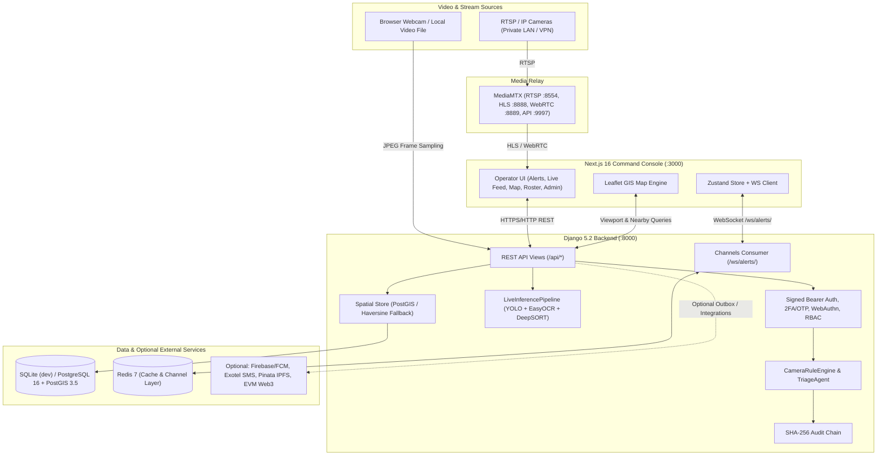
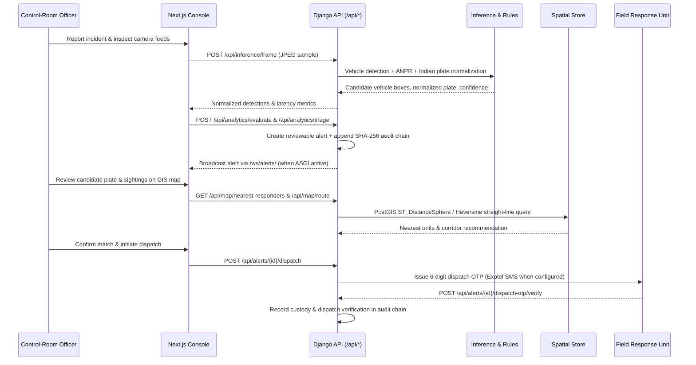

# Sentrix — System Architecture & Technical Design

**Focus:** Hit-and-Run Vehicle Tracing & Cross-Camera Investigation Platform

---

## 1. Executive Architecture Summary

Sentrix is an AI-assisted, GIS-enabled public safety investigation platform designed for district control-room duty officers. It unifies live or relayed CCTV video ingestion, computer vision inference (vehicle detection, Indian ANPR, person tracking), geospatial visualization, and human-reviewed incident and dispatch workflows in a single console.

The architecture separates concerns into four layers:

1. **Frontend Presentation & GIS Canvas** (`frontend/`): Next.js 16 (App Router), React 18, TypeScript, Tailwind CSS, Zustand, Leaflet (`react-leaflet`), and `hls.js`.
2. **Backend API & Real-Time Layer** (`backend/`): Django 5.2 on Python 3.12, Django Channels + Daphne (ASGI) for WebSockets, and Gunicorn (WSGI) in the production Compose baseline.
3. **AI & Computer Vision Inference Pipeline** (`backend/app/services/inference/`): Lazy-loaded Ultralytics YOLO, EasyOCR with Indian registration-plate normalization, DeepSORT tracking, and optional face-detection boundaries.
4. **Persistence, Spatial Store & Integrity Layer** (`backend/app/models.py`, `spatial_store.py`, `audit/chain.py`): SQLite (local default) or PostgreSQL 16 + PostGIS 3.5, Redis 7 (optional channel layer and cache), and a local SHA-256 hash chain for `alerts` and `activityLog`.

---

## 2. High-Level System Architecture

---

## 3. Component Responsibilities

| Component | Location | Responsibility |
|---|---|---|
| **REST API & Views** | `backend/app/api/views.py`, `backend/app/api/routes/map.py` | Handles authentication, camera registry, inference frame evaluation, alert lifecycle, watchlist, dispatch, and geospatial queries under `/api/*`. |
| **WebSocket Consumer & Broadcaster** | `backend/app/api/consumers.py`, `backend/app/services/broadcaster.py` | Pushes `alert.created`, `alert.updated`, `camera.updated`, `dispatch.created`, `dispatch.verified`, `system.updated`, and `activity.created` events over `/ws/alerts/`. |
| **State Repository** | `backend/app/api/repository.py`, `backend/app/models.py` | Manages canonical operational state (`ApiStateDocument` in SQLite/PostgreSQL or `.localdata/api_state.json`), enforces auth user separation, and appends SHA-256 audit-chain entries. |
| **AI Inference Pipeline** | `backend/app/services/inference/` | Runs lazy-loaded YOLO vehicle/person detection, ANPR (plate detector or vehicle-crop OCR fallback), and optional face detection; returns normalized bounding boxes, confidence, and latency metrics. |
| **Rule Engine & Triage** | `backend/app/services/analytics/rules.py`, `backend/app/services/triage/agent.py` | Evaluates explainable camera-scoped rules (virtual fence, dwell time, night movement, repeated plate, crowd formation) and fuses observations into operator-reviewable incident candidates. |
| **Spatial Store** | `backend/app/services/spatial_store.py` | Projects `communities`, `resources`, `infrastructure`, and `roads` into PostGIS `sentrix_spatial_features` (`SRID 4326`, GiST index) with automatic Haversine straight-line fallback. |
| **Camera Relay & Validation** | `backend/app/services/cameras/connection.py`, `relay.py` | Enforces RFC 1918 / link-local / loopback private-IP rules for RTSP URLs, masks credentials from browser APIs, and registers paths with MediaMTX. |
| **Audit Chain & Evidence** | `backend/app/services/audit/chain.py`, `backend/app/services/evidence/` | Maintains a tamper-evident SHA-256 hash chain over `alerts` and `activityLog`; includes optional, disabled-by-default Pinata/IPFS and `EvidenceRegistry.sol` adapters. |
| **Frontend Console** | `frontend/app/(console)/`, `frontend/components/`, `frontend/lib/` | Renders the operator dashboard, live camera matrix, alert triage log, Leaflet GIS map, guard roster, and admin controls. |

---

## 4. End-to-End Hit-and-Run Investigation Data Flow

---

## 5. AI Inference Pipeline

### 5.1 Execution Model

- **Lazy loading:** Model weights are never loaded at Django startup. Each service loads weights on first inference call.
- **Per-camera state:** `LiveInferencePipeline` caches frame-skip state and DeepSORT tracker state per camera ID so track IDs do not bleed across streams.
- **Device selection:** `backend/app/services/inference/device.py` resolves `CUDA` -> `MPS` -> `CPU` based on `AI_DEVICE` and hardware availability.

### 5.2 Vehicle Detection & ANPR (`backend/app/services/inference/anpr/`)

1. **Vehicle localization:** Uses Ultralytics YOLO filtered to COCO vehicle classes (`2`: car, `3`: motorcycle, `5`: bus, `7`: truck) with configurable `ANPR_VEHICLE_MODEL_PATH` (defaults to `yolov8n.pt`).
2. **Plate localization:** Uses `ANPR_PLATE_MODEL_PATH` (e.g., `INPD_more_accuracy_n.pt`) when present. If the dedicated plate weight is absent, `AnprService` falls back to scanning cropped vehicle regions with EasyOCR (`ocr_mode: "vehicle_crop_fallback"`).
3. **Plate normalization (`plate_format.py`):**
   - Strips non-alphanumeric characters and checks length (`8–11` characters).
   - Evaluates legal Indian state/district/series/number splits against `^[A-Z]{2}\d{1,2}[A-Z]{1,3}\d{1,4}$`.
   - Corrects common OCR confusions (`0↔O`, `1↔I/L`, `2↔Z`, `5↔S`, `8↔B`, `D/Q→0`) by selecting the valid split requiring the fewest substitutions.
4. **Confidence:** Reports `min(plate_detector_confidence, ocr_confidence)` for dedicated plate detection, or OCR confidence for vehicle-crop fallback.

### 5.3 Human-in-the-Loop Boundary

`LiveInferencePipeline` performs **detection only**: it does not automatically dispatch units or confirm a suspect vehicle. `CameraRuleEngine` and `TriageAgent` produce **candidate** alerts with `requiresOperatorReview: true`, requiring an authenticated operator to acknowledge, escalate, or dispatch.

---

## 6. Cross-Camera Vehicle Tracing Logic

### Currently Implemented

- **Single-camera repeated plate rule:** `CameraRuleEngine` (`rules.py`) tracks normalized plates per camera over a rolling 300-second window and raises a `repeated_plate` candidate event when occurrences reach `repeatedPlateThreshold` (default `3`).
- **Plate watchlist:** Operators can register `plate` entries via `POST /api/watchlist` and inspect them in the console.
- **Alert & map linkage:** Alerts store `plateNumber`, `sourceCameraId`, `timestamp`, and camera-level `coordinates`, allowing operators to filter and inspect sightings on the Leaflet map.

### Planned (Not Yet Implemented End-to-End)

- Automated **cross-camera association** that links candidate sightings across multiple cameras using fuzzy plate edit-distance similarity, inter-camera straight-line/road distance, and travel-time plausibility scoring, rendered as an automated multi-camera trail with per-link confidence.

---

## 7. GIS & Mapping Integration

- **Coordinate model:** Incident and detection coordinates represent **camera-level or field-of-view locations** (WGS84 `lat`/`lng`), not image-to-ground homography projections of a vehicle's exact street position.
- **Database projection (`spatial_store.py`):**
  - Table: `sentrix_spatial_features` (`collection`, `record_id`, `payload` JSONB, `geom` `geometry(Geometry, 4326)`) with a GiST index.
  - Collections projected: `communities`, `resources`, `infrastructure` (`Point`), and `roads` (`LineString`).
  - Queries: `ST_MakeEnvelope` + `ST_Intersects` for viewport bounding boxes (`/api/map/features`), and `ST_DWithin` + `ST_DistanceSphere` for radial proximity (`/api/map/nearby`, `/api/map/nearest-responders`, `/api/map/route`).
- **Fallback:** When running on SQLite or when `SENTRIX_STATE_STORAGE` is not `postgres`, `spatial_store.py` computes **straight-line Haversine** distances in memory. Neither mode performs road-network drive-time routing.

---

## 8. Database Design

Sentrix uses a hybrid persistence model:

1. **`sentrix_api_state` (`ApiStateDocument` in `backend/app/models.py`):** Stores the canonical operational state document (`alerts`, `cameras`, `guards`, `shifts`, `activityLog`, `watchlistEntries`, `auditChain`, `communities`, `resources`, `infrastructure`, `roads`, `authUsers`) in SQLite (local dev) or PostgreSQL JSONB (production).
2. **`sentrix_spatial_features` (PostgreSQL/PostGIS migration `0002_spatial_features.py`):** Spatial projection table with `GEOMETRY(Geometry, 4326)` and a GiST index for geospatial queries.
3. **Optional Firestore projection (`backend/app/services/evidence/alert_store.py`):** Idempotent alert sync and append-only `alerts_events` with a bounded local retry outbox (up to 8 attempts with exponential backoff before dead-lettering).

> **Architectural boundary:** Because canonical operational records currently reside in a single `ApiStateDocument`, `docker-compose.production.yml` intentionally runs Gunicorn with `--workers 1` until records are normalized into separate relational tables.

---

## 9. API & WebSocket Communication

- **REST Base Path:** `/api` (no `/api/v1/` prefix exists).
- **WebSocket Endpoint:** `/ws/alerts/` via `backend/config/asgi.py` and `backend/app/api/routing.py`.
  - Uses `InMemoryChannelLayer` locally and `channels_redis.core.RedisChannelLayer` when `SENTRIX_REDIS_URL` is set.
  - **Deployment note:** `docker-compose.production.yml` currently launches `gunicorn config.wsgi:application` (WSGI), which does not serve WebSocket upgrades on `/ws/alerts/`. Serving WebSockets in production requires running an ASGI server (e.g., `daphne config.asgi:application`) behind Caddy.
- **Authentication:**
  - `POST /api/auth/login` -> optional 2FA OTP (`POST /api/auth/verify-otp`) or WebAuthn passkey (`POST /api/auth/passkey/options`, `/verify`) -> returns a signed 12-hour `Bearer` token (`django.core.signing`, salt `borderlens.console.auth` in code).
  - Protected endpoints validate signature, expiry, `disabled` flag, and `tokenVersion`.
  - Sensitive writes (e.g., dispatch, user revocation, guard creation, blockchain anchoring) enforce `command` or `admin` tiers.

---

## 10. Security & Evidence Integrity Architecture

- **Private-IP SSRF protection:** `backend/app/services/cameras/connection.py` restricts RTSP camera targets to RFC 1918 private subnets, link-local, or loopback addresses; public IPs are rejected.
- **Credential isolation:** RTSP passwords and raw RTSP URLs are stripped from API responses (`/api/bootstrap`, `/api/cameras/<id>`, `/api/cameras/<id>/stream`).
- **Tamper-evident SHA-256 audit chain (`backend/app/services/audit/chain.py`):**
  - Every mutation to `alerts` and `activityLog` appends a sequence-numbered entry containing `contentHash`, `previousHash`, `chainHash`, `operation`, and UTC timestamp.
  - `GET /api/audit-chain` recomputes every link from `GENESIS_HASH` (`"0" * 64`) to detect retroactive edits or deletions.
  - **Limitation:** A local hash chain detects tampering after the fact; it does not by itself prove truthfulness at write time or provide legal admissibility without external access controls and durable append-only storage.
