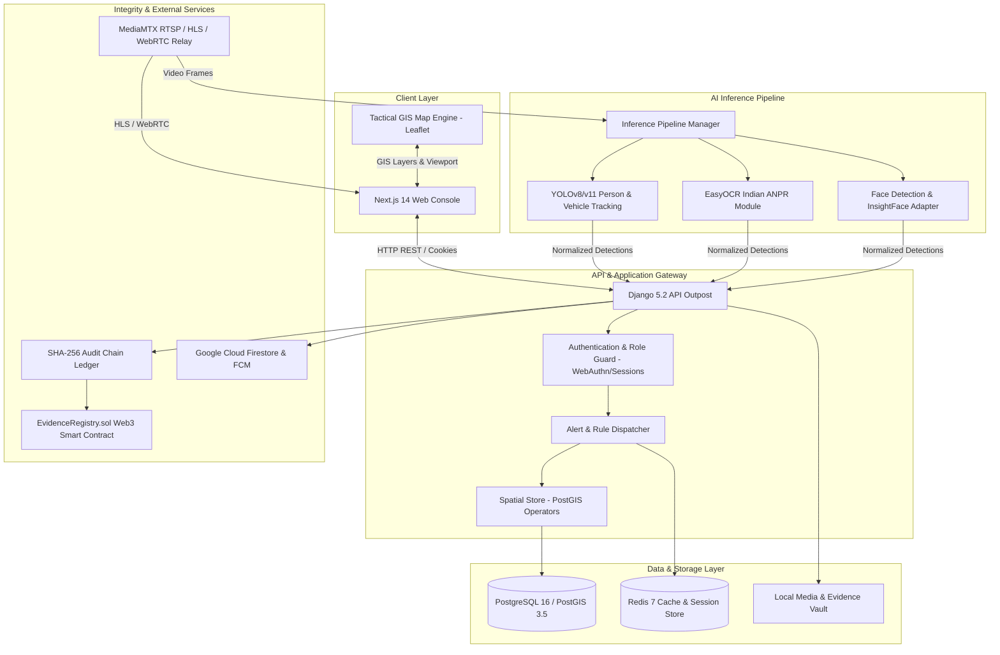
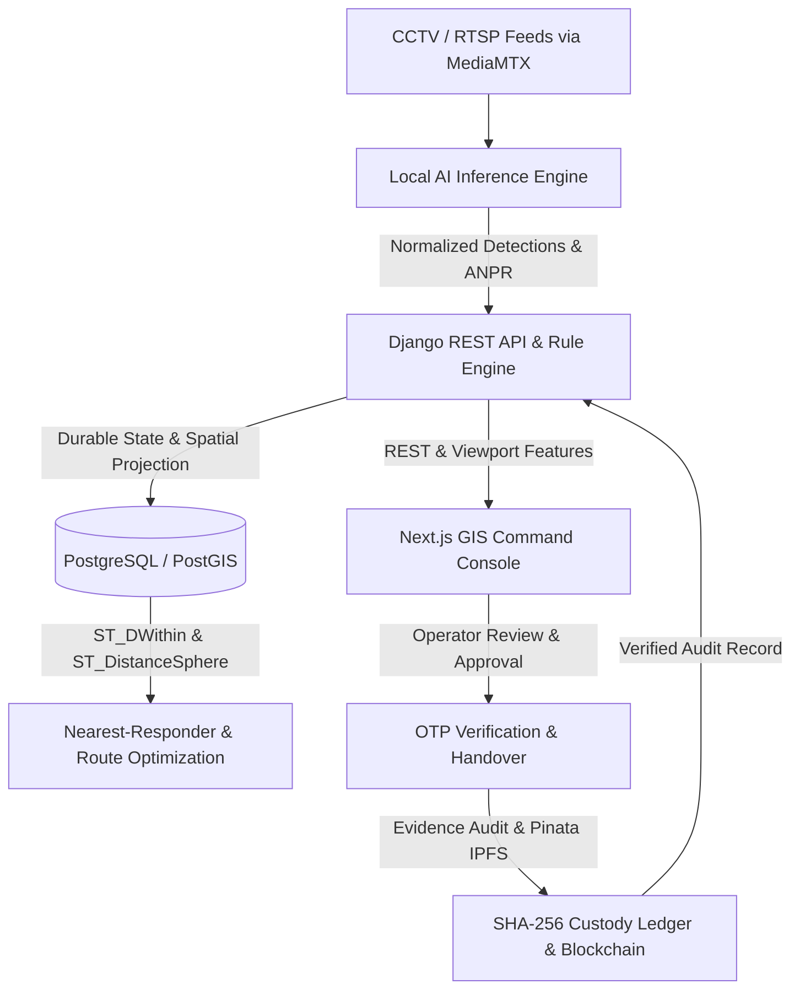

# Sentrix - System Architecture & Technical Design

## 1. Executive Architecture Summary

Sentrix is designed as an edge-capable, cloud-ready AI-GIS intelligence platform. It couples real-time computer vision inference with geospatial vector analysis, cryptographic evidence verification, and dispatch coordination.

The architecture isolates concerns into four decoupled layers:
1. **Frontend Presentation & GIS Canvas** (Next.js 14+ / React / Leaflet)
2. **Backend Outpost Service & API** (Django 5.2+ REST, PostGIS, WebAuthn)
3. **Computer Vision & Inference Pipeline** (YOLOv8/v11, EasyOCR, DeepSORT)
4. **Data Persistence & Cryptographic Evidence** (PostgreSQL/PostGIS, Redis, IPFS Pinata, Ethereum/Polygon Web3)

---

## 2. High-Level Architecture Diagram

---

## 3. The Five-Stage Operational Intelligence Loop

1. **Detect**: Ingest RTSP/HLS camera streams to identify persons, vehicles, and license plates via decoupled YOLO and OCR workers.
2. **Locate**: Project detections into WGS84 geographic coordinate space with PostGIS `ST_SetSRID(ST_MakePoint(lng, lat), 4326)` and bounding box envelopes.
3. **Understand**: Deduplicate track IDs across frames, correlate camera events, and cross-reference opt-in consent registries.
4. **Predict**: Evaluate sector alert densities, analyze camera coverage cones, and evaluate perimeter breach rules.
5. **Respond**: Execute database-level spatial proximity queries (`ST_DWithin`, `ST_DistanceSphere`) to dispatch the nearest field responder with time-limited OTP handovers.

---

## 4. Subsystem Design & Technical Specifications

### 4.1 Backend Outpost Service (`backend/app/`)
* **Framework**: Django 5.2 running on Python 3.12.
* **API Endpoints**: Rooted directly at `/api` (e.g. `/api/health`, `/api/bootstrap`, `/api/alerts`, `/api/map/workspace`, `/api/map/nearest-responders`, `/api/map/route`).
* **Database Agility**: Dynamically supports PostGIS (`django.contrib.gis.db.backends.postgis`) in production and SQLite in lightweight development environments.
* **Authentication**: Signed sessions, rate-limited login attempts, role-based access control (Admin, Operator, Guard), and passwordless WebAuthn / FIDO2 security keys.

### 4.2 Geospatial Store & PostGIS Projection (`backend/app/services/spatial_store.py`)
* **Table**: `sentrix_spatial_features`
* **Geometry**: `geometry(Geometry, 4326)` indexed with a spatial **GiST index** (`sentrix_spatial_features_geom_gist`).
* **Spatial Operators**:
  * `ST_DWithin(geom::geography, point::geography, radius_meters)`: Fast index-backed radial queries.
  * `ST_DistanceSphere(geom, point) / 1000.0`: Geodesic distance calculation in kilometers.
  * `geom && ST_MakeEnvelope(w, s, e, n, 4326)`: Two-dimensional bounding box index intersection.
* **Fallback**: Graceful fallback to Haversine great-circle calculation when running against non-PostGIS storage.

### 4.3 AI & Inference Pipeline (`backend/app/services/inference/`)
* **Person Tracking**: YOLOv8/v11 person class localization paired with DeepSORT tracking across sequential frames.
* **ANPR**: Dual-mode license plate detector with vehicle-crop fallback OCR and Indian registration plate format normalization.
* **Face Detection**: Local Haar cascade fallback and InsightFace embeddings interface governed by opt-in consent rules.
* **Hardware Acceleration**: Automatic runtime device selection (`CUDA` -> `MPS` -> `CPU`).

### 4.4 Media Relay (`infrastructure/docker/mediamtx.yml`)
* MediaMTX handles RTSP stream ingestion (port 8554), HLS playback (port 8888), WebRTC playback (port 8889), and management API (port 9997).
* Private network sanitization ensures RTSP URLs cannot be exploited for SSRF attacks against internal network hosts.

### 4.5 Evidence Ledger & Blockchain Integration (`backend/app/services/evidence/`)
* **Cryptographic Hashing**: Media frames and custody handover logs are hashed with SHA-256.
* **Tamper-Evident Audit Chain**: SHA-256 hash chains record all administrative actions, alert acknowledgments, and dispatches.
* **Smart Contract**: `EvidenceRegistry.sol` (Solidity 0.8+) anchors evidence hashes immutably to Ethereum or Polygon EVM testnets/mainnets via Web3.py.
* **Off-Chain Storage**: Encrypted evidence files uploaded to IPFS via Pinata API and synced to Google Cloud Firestore.

---

## 5. Security & Privacy Architecture

1. **Consent-Based Biometrics**: Face matching is strictly opt-in and consent-verified for missing persons or authorized personnel.
2. **Server-Side Feature Vectors**: High-dimensional embeddings never leave backend memory and are never exposed to browser DOMs.
3. **Mandatory Human-in-the-Loop**: AI detections produce candidate flags only; operational action requires human verification.
4. **Demographic Neutrality**: Models classify objects and geometric attributes only; demographic inference is strictly disallowed.
5. **Zero-Trust Network Segmentation**: Docker production stack isolates database, cache, and media relay behind internal networks; only Caddy edge proxy publishes host ports 80/443.

